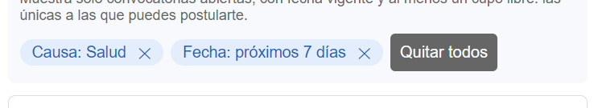
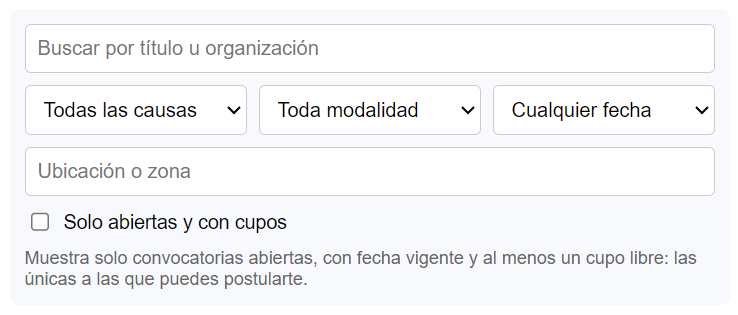
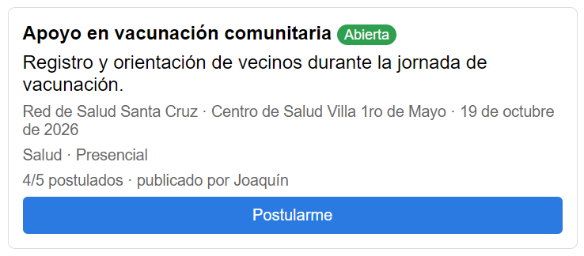

# Decisiones de interacción (clase 16)

Funcionalidad: encontrar una convocatoria y postularse.

Revisamos la lista de convocatorias, los filtros y la tarjeta de cada convocatoria con tres principios: Fitts (alcanzar), Hick (elegir) y carga cognitiva (comprender).

| Hallazgo | Captura | Justificación | Estado |
|---|---|---|---|
| Fitts | Quitar un filtro activo | El botón ✕ mide 23 x 18 px y solo esa parte se puede tocar | Documentado |
| Hick | Panel de filtros | Seis controles aparecen a la vez antes de ver una sola convocatoria | Documentado |
| Carga cognitiva | Cupos en la tarjeta | Hay que restar "4/5" para saber cuántos cupos quedan | Documentado |

## Fitts

Pantalla: Dashboard, etiquetas de filtros activos ("Causa: Salud ✕").  
Qué observamos: para quitar un filtro hay que tocar la ✕. Medimos el botón en la app y mide 23 x 18 px. El resto de la etiqueta no hace nada al tocarla.  
Justificación: el objetivo es pequeño y el área activa es solo el ícono, así que exige apuntar con precisión, sobre todo en el celular.  
Código: [FiltrosConvocatorias.tsx](../frontend/ithc/src/anuncios/components/FiltrosConvocatorias.tsx#L76), [index.css](../frontend/ithc/src/index.css)  
Captura:

## Hick

Pantalla: Dashboard, panel de filtros.  
Qué observamos: antes de ver la lista aparecen búsqueda, causa, modalidad, fecha, ubicación y "Solo abiertas y con cupos". Son seis decisiones con la misma importancia.  
Justificación: todas compiten al mismo tiempo. Lo más usado (buscar y ver solo las disponibles) podría quedar visible y el resto ir en "Más filtros".  
Código: [FiltrosConvocatorias.tsx](../frontend/ithc/src/anuncios/components/FiltrosConvocatorias.tsx#L11)  
Captura:

## Carga cognitiva

Pantalla: tarjeta de una convocatoria, por ejemplo "Apoyo en vacunación comunitaria".  
Qué observamos: la tarjeta dice "4/5 postulados". Para decidir si postularse hay que restar y darse cuenta de que queda un solo cupo. No se distingue una convocatoria con un cupo de una con muchos.  
Justificación: la persona tiene que interpretar y calcular un dato que la app ya conoce. Lo que necesita en ese momento es cuántos cupos quedan.  
Código: [AnuncioCard.tsx](../frontend/ithc/src/anuncios/components/AnuncioCard.tsx#L66)  
Captura:

## Hallazgo elegido

Elegimos carga cognitiva porque aparece en todas las tarjetas, justo cuando la persona decide si se postula. Fitts y Hick quedan documentados para corregir después.
