# Evaluación heurística H1 a H10

Funcionalidad evaluada: encontrar una convocatoria y postularse.

Recorrido: Dashboard, filtros, tarjeta de la convocatoria y botón Postularme.

Probamos un caso permitido (Alfabetización digital en Cochabamba, abierta y con cupos) y casos bloqueados: Huerto escolar (cerrada), Tutorías de matemática (sin cupos) y Acompañamiento a adultos mayores (fecha pasada).

Issue principal: #9

| H | Heurística | Estado | Sub-issue |
|---|---|---|---|
| H1 | Visibilidad del estado del sistema | Corregida | #10 |
| H2 | Relación con el mundo real | Corregida | #11 |
| H3 | Control y libertad del usuario | Corregida | #12 |
| H4 | Consistencia y estándares | Corregida | #13 |
| H5 | Prevención de errores | Cumple | |
| H6 | Reconocer antes que recordar | Cumple | |
| H7 | Flexibilidad y eficiencia | Cumple | |
| H8 | Diseño estético y minimalista | Corregida | #14 |
| H9 | Reconocer y recuperarse de errores | Corregida | #15 |
| H10 | Ayuda y documentación | Corregida | #16 |

Severidad: 0 no es problema, 1 cosmético, 2 menor, 3 mayor, 4 catastrófico.

## H1 Visibilidad del estado del sistema

Estado: corregida (#10)  
Pantalla: Dashboard, tarjeta de la convocatoria, botón Postularme.  
Problema: al postularse no salía ningún mensaje de confirmación, y las convocatorias vencidas seguían diciendo "abierta".  
Consecuencia: el usuario no sabe si se postuló y puede pensar que una vencida todavía está disponible.  
Severidad: 3  
Corrección: ahora sale "Postulación enviada" junto al botón y la etiqueta "Vencida" cuando la fecha ya pasó.  
Código: [AnuncioCard.tsx](../frontend/ithc/src/anuncios/components/AnuncioCard.tsx#L32), [convocatoria.ts](../frontend/ithc/src/domain/convocatoria.ts#L56)  
Antes:  
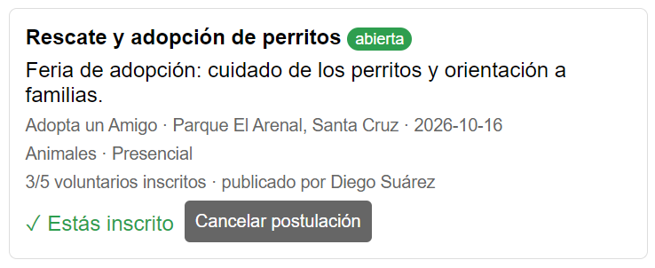  
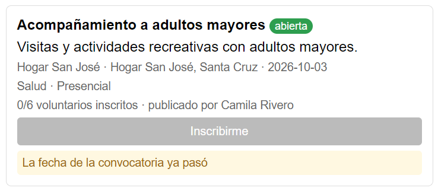  
Después:  
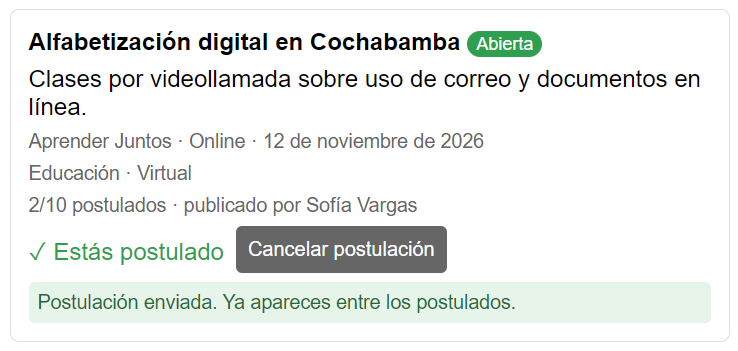  
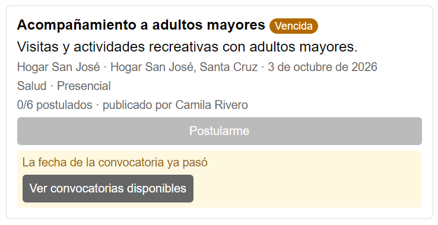

## H2 Relación con el mundo real

Estado: corregida (#11)  
Pantalla: tarjeta de cualquier convocatoria.  
Problema: la fecha salía como 2026-10-03 y el estado en minúscula, tal como se guarda en la base de datos.  
Consecuencia: hay que interpretar la fecha para saber cuándo es la actividad.  
Severidad: 2  
Corrección: la fecha se muestra como "3 de octubre de 2026" y el estado como "Abierta", "Cerrada" o "Vencida".  
Código: [convocatoria.ts](../frontend/ithc/src/domain/convocatoria.ts#L59), [AnuncioCard.tsx](../frontend/ithc/src/anuncios/components/AnuncioCard.tsx#L52)  
Antes:  
  
Después:  

## H3 Control y libertad del usuario

Estado: corregida (#12)  
Pantalla: tarjeta de una convocatoria a la que ya me postulé.  
Problema: la postulación no se podía deshacer.  
Consecuencia: si alguien se postula por error, sigue ocupando un cupo que otro estudiante podría usar.  
Severidad: 3  
Corrección: se agregó el botón "Cancelar postulación", que libera el cupo. No se puede cancelar si la actividad ya pasó.  
Código: [AnuncioService.java](../backend/voluntarioserca/src/main/java/com/ithc/voluntarioserca/anuncios/AnuncioService.java#L98), [AnuncioController.java](../backend/voluntarioserca/src/main/java/com/ithc/voluntarioserca/anuncios/AnuncioController.java#L107)  
Antes:  
  
Después:  

## H4 Consistencia y estándares

Estado: corregida (#13)  
Pantalla: tarjeta de la convocatoria e inicio de sesión.  
Problema: la misma acción se llamaba "Inscribirme", "postularte", "Estás inscrito" y "Postulados". En el login el título decía "Iniciar sesión" y el botón "Login".  
Consecuencia: no queda claro si inscribirse y postularse son lo mismo.  
Severidad: 2  
Corrección: ahora todo dice "postular", también los mensajes del backend, y los botones dicen "Iniciar sesión" y "Crear cuenta".  
Código: [AnuncioCard.tsx](../frontend/ithc/src/anuncios/components/AnuncioCard.tsx#L90), [convocatoria.ts](../frontend/ithc/src/domain/convocatoria.ts#L78), [AnuncioService.java](../backend/voluntarioserca/src/main/java/com/ithc/voluntarioserca/anuncios/AnuncioService.java#L82), [LoginPage.tsx](../frontend/ithc/src/auth/pages/login/LoginPage.tsx#L45), [RegisterPage.tsx](../frontend/ithc/src/auth/pages/register/RegisterPage.tsx#L62)  
Antes:  
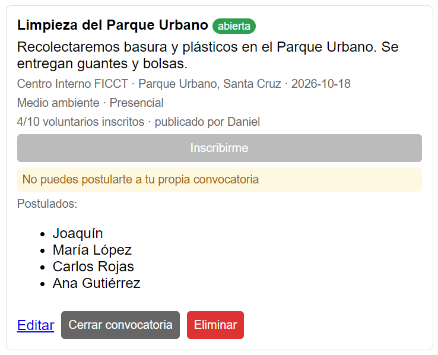  
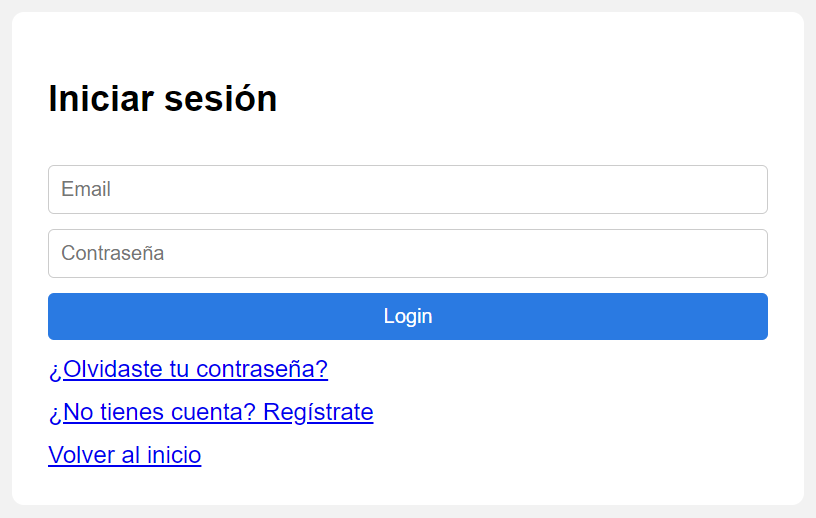  
Después:  
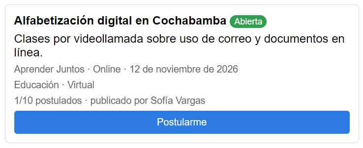  

## H5 Prevención de errores

Estado: cumple  
Pantalla: tarjeta de una convocatoria cerrada, sin cupos o vencida.  
Cómo lo comprobamos: intentamos postularnos a una cerrada y a una sin cupos; el botón está desactivado y el backend también lo rechaza. Para eliminar una convocatoria se pide confirmación.  
Código: [AnuncioCard.tsx](../frontend/ithc/src/anuncios/components/AnuncioCard.tsx#L85), [AnuncioService.java](../backend/voluntarioserca/src/main/java/com/ithc/voluntarioserca/anuncios/AnuncioService.java#L76)  
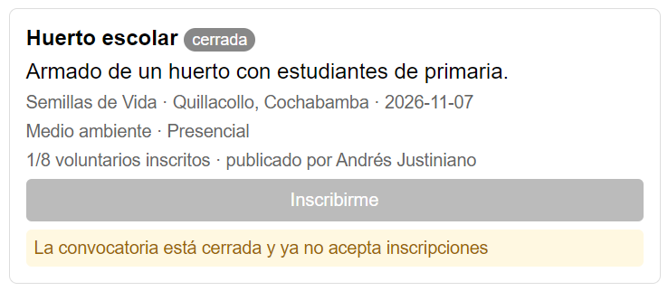  
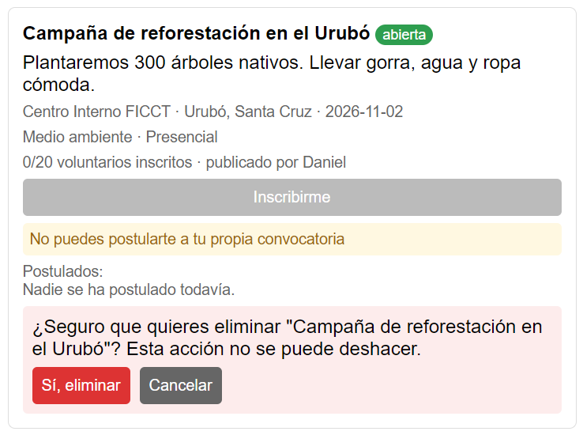

## H6 Reconocer antes que recordar

Estado: cumple  
Pantalla: tarjeta de la convocatoria.  
Cómo lo comprobamos: antes de pulsar "Postularme" se ven en la misma tarjeta la fecha, el lugar, la modalidad y los cupos. No hay que ir a otra pantalla para decidir.  
Código: [AnuncioCard.tsx](../frontend/ithc/src/anuncios/components/AnuncioCard.tsx#L52)  
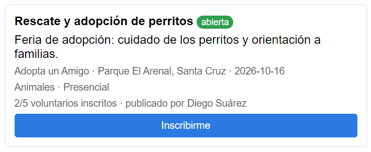

## H7 Flexibilidad y eficiencia

Estado: cumple  
Pantalla: filtros del Dashboard.  
Cómo lo comprobamos: usamos los atajos "Hoy" y "Próximos 7 días" con la causa. Los filtros activos se ven como etiquetas y se pueden quitar uno por uno o todos juntos.  
Código: [FiltrosConvocatorias.tsx](../frontend/ithc/src/anuncios/components/FiltrosConvocatorias.tsx#L76), [AnunciosProvider.tsx](../frontend/ithc/src/anuncios/context/AnunciosProvider.tsx#L44)  
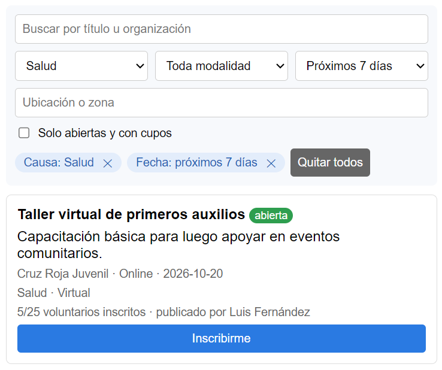

## H8 Diseño estético y minimalista

Estado: corregida (#14)  
Pantalla: convocatorias creadas por el usuario.  
Problema: en las convocatorias propias salía el botón gris "Inscribirme" y el aviso "No puedes postularte a tu propia convocatoria".  
Consecuencia: cada tarjeta propia tenía un botón y un aviso que no sirven, y las acciones del creador quedaban más abajo.  
Severidad: 1  
Corrección: al creador ya no se le muestra la parte de postulación.  
Código: [AnuncioCard.tsx](../frontend/ithc/src/anuncios/components/AnuncioCard.tsx#L70)  
Antes:  
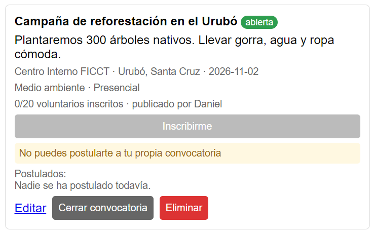  
Después:  
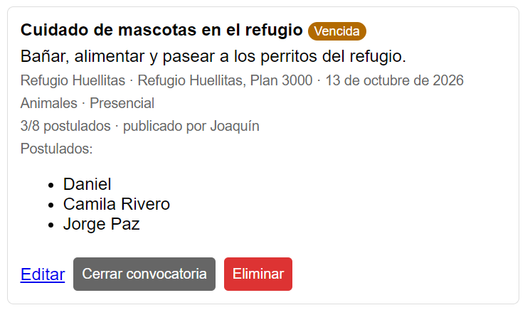

## H9 Reconocer y recuperarse de errores

Estado: corregida (#15)  
Pantalla: convocatoria sin cupos, cerrada o vencida.  
Problema: el mensaje decía el motivo ("No quedan cupos disponibles") pero no daba una salida.  
Consecuencia: el usuario tiene que buscar solo otra convocatoria.  
Severidad: 2  
Corrección: junto al motivo está el botón "Ver convocatorias disponibles", que activa el filtro de disponibles.  
Código: [AnuncioCard.tsx](../frontend/ithc/src/anuncios/components/AnuncioCard.tsx#L44)  
Antes:  
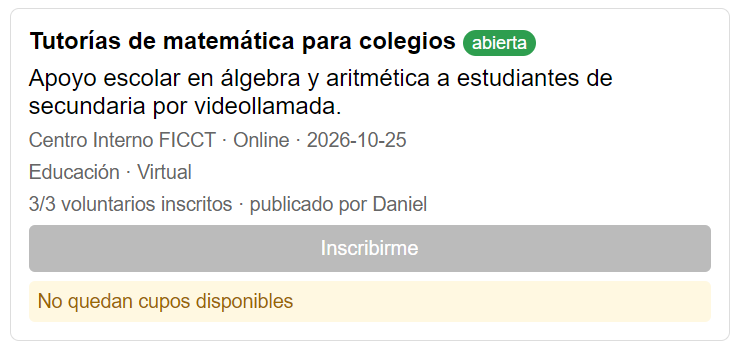  
Después:  
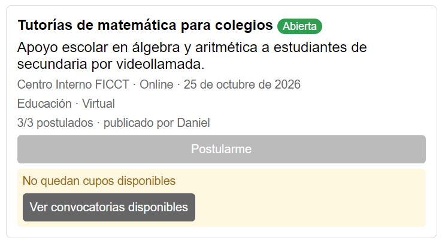

## H10 Ayuda y documentación

Estado: corregida (#16)  
Pantalla: lista de convocatorias y filtro "Solo abiertas y con cupos".  
Problema: no había ayuda sobre qué incluye el filtro de disponibles ni sobre qué pasa al postularse.  
Consecuencia: no se entiende por qué desaparecen convocatorias al activar el filtro, ni que la postulación se puede cancelar.  
Severidad: 1  
Corrección: un texto corto debajo del título "Convocatorias" y otro debajo del filtro.  
Código: [FiltrosConvocatorias.tsx](../frontend/ithc/src/anuncios/components/FiltrosConvocatorias.tsx#L70), [Dashboard.tsx](../frontend/ithc/src/pages/dashboard/Dashboard.tsx#L22)  
Antes:  
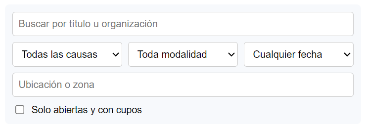  
Después:  
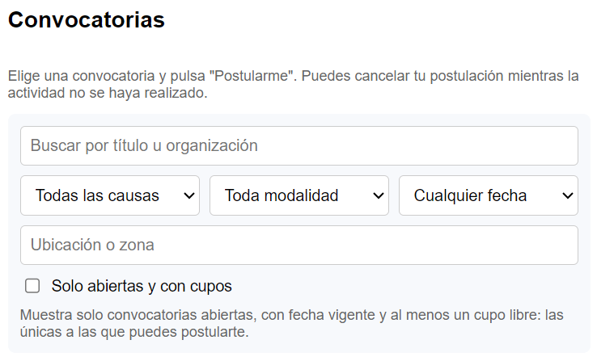

## Comprobación

Volvimos a hacer el recorrido con otro usuario (Joaquín): nos postulamos, vimos la confirmación, cancelamos y entramos a una convocatoria sin cupos para usar "Ver convocatorias disponibles". Las pruebas del frontend y del backend pasan.
