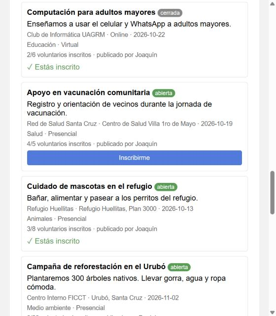
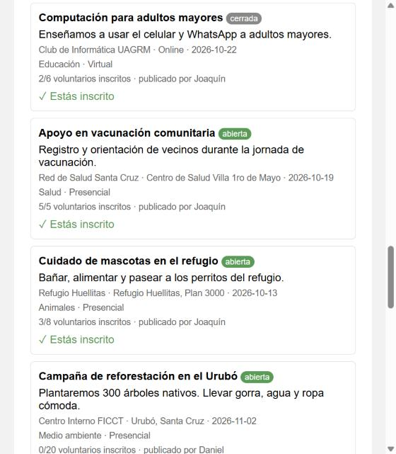
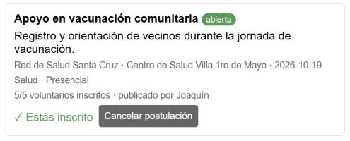
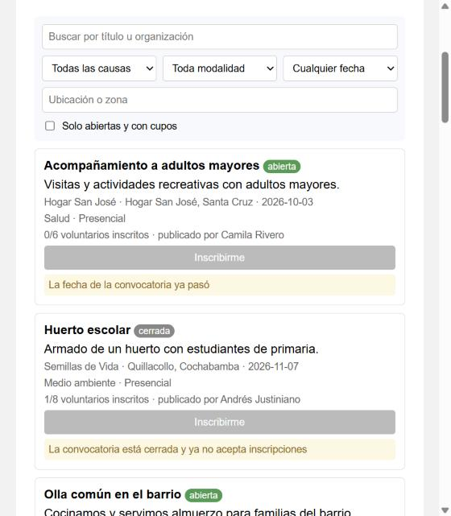
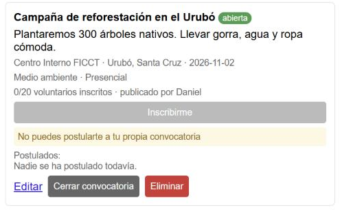

# Hallazgos · Heurísticas de Nielsen

**Acción evaluada:** postularse a una convocatoria (usuario estudiante).

| # | Pantalla y evidencia | Problema y consecuencia | Heurística | Severidad |
|:-:|---|---|---|:-:|
| 1 | Dashboard → "Apoyo en vacunación comunitaria" (4/5) → clic en **Inscribirme**. La tarjeta solo muestra "✓ Estás inscrito". | La postulación no se puede deshacer. Si el estudiante se equivoca o ya no puede asistir, sigue ocupando un cupo que otro podría usar. | **H3** · Control y libertad del usuario | **3** |
| 2 | Tarjeta "Acompañamiento a adultos mayores": etiqueta verde **abierta**, fecha `2026-10-03` y aviso "La fecha de la convocatoria ya pasó". | La etiqueta dice "abierta" pero no se puede postular. La convocatoria vencida aparece primera y la fecha está en formato técnico. | **H1** · Visibilidad del estado del sistema **H2** · Relación con el mundo real | **2** |
| 3 | Convocatorias propias: botón gris **Inscribirme** y aviso "No puedes postularte a tu propia convocatoria". | Botón y aviso innecesarios en cada tarjeta propia. Agregan ruido visual y alargan la lista. | **H8** · Diseño estético y minimalista | **1** |

**Severidad:** 0 = no es problema · 1 = cosmético · 2 = menor · 3 = grave · 4 = catastrófico

## Capturas

### Hallazgo 1 · Antes y después

| Antes: antes de postularse | Antes: sin opción de cancelar | Después: cancelar postulación |
|:-:|:-:|:-:|
|  |  |  |

### Hallazgo 2 · Convocatoria vencida marcada como abierta

### Hallazgo 3 · Botón y aviso innecesarios en la convocatoria propia

